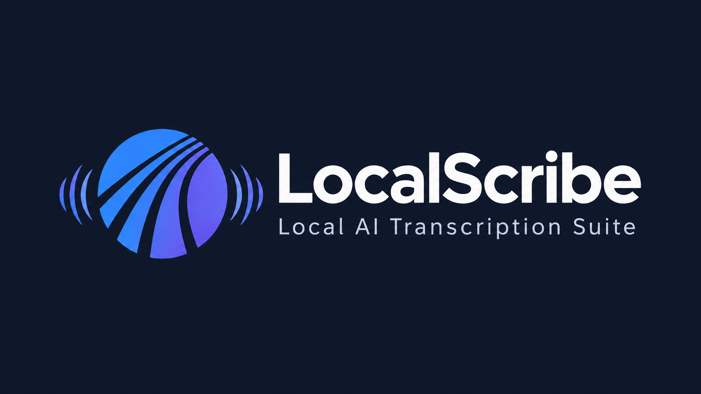
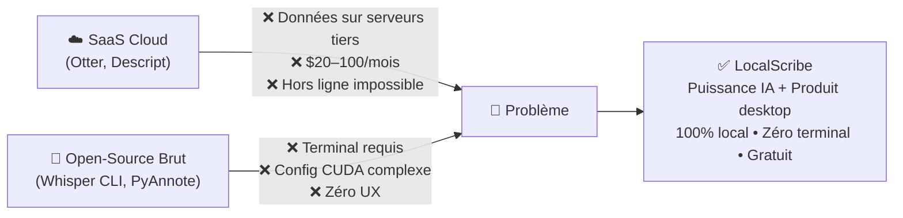
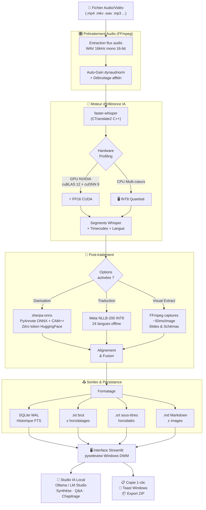
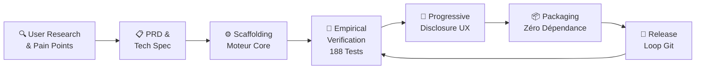
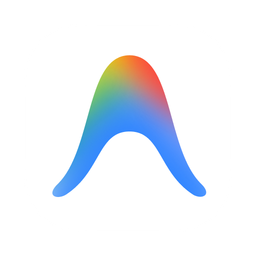

<div align="center">

  

  <br/><br/>

  # 🎙️ LocalScribe
  ### Studio Desktop IA de Transcription, Diarisation & Traduction — 100% Local, Privé & Zéro-Terminal

  [](https://github.com/LyesHarrar/LocalScribe/releases/latest)
  [](https://github.com/LyesHarrar/LocalScribe)
  [](https://github.com/LyesHarrar/LocalScribe)
  [](https://github.com/LyesHarrar/LocalScribe)
  [](LICENSE)

  <br/>

  <p align="center">
    <a href="https://github.com/LyesHarrar/LocalScribe/releases/latest/download/LocalScribe-v2.6.1-Portable-Windows-x64.zip">
      
    </a>
    <br/>
    <small><a href="https://github.com/LyesHarrar/LocalScribe/releases/latest">📦 Consulter les notes de version v2.6.1 sur GitHub</a></small>
  </p>

  <p align="center">
    <a href="#-tldr--executive-summary">TL;DR</a> •
    <a href="#-pourquoi-localscribe--le-problème-du-marché">Pourquoi LocalScribe ?</a> •
    <a href="#-fonctionnalités-v261">Fonctionnalités</a> •
    <a href="#%EF%B8%8F-architecture--stack-technique">Architecture & Stack</a> •
    <a href="#-démarche-produit--ingénierie">Démarche Produit</a> •
    <a href="#-démarrage-rapide">Démarrage Rapide</a>
  </p>

</div>

---

## ⚡ TL;DR — Executive Summary

> **LocalScribe** est une application de bureau Windows complète qui transforme n'importe quel fichier audio ou vidéo en transcription structurée, sous-titres, traduction et synthèses IA, **entièrement sur votre machine**, sans Internet, sans abonnement, et avec une confidentialité absolue.

**Ce que c'est :** Un studio desktop autonome clé en main, propulsé par les moteurs d'IA open-source les plus performants du marché (Whisper, CTranslate2, sherpa-onnx, NLLB-200), empaqueté dans une interface fluide (Streamlit + pywebview natif Windows), sans aucune ligne de commande pour l'utilisateur final.

**🌱 Origine du projet :** LocalScribe est l'évolution personnelle et le perfectionnement d'un logiciel d'abord développé et livré sur-mesure pour des clients ayant des contraintes métiers strictes :
- 🧠 **Psychologues & Thérapeutes :** Transcription sécurisée de consultations et d'entretiens cliniques (secret médical absolu, zéro cloud).
- 🎬 **Streamers & Créateurs de contenu :** Sous-titrage rapide `.srt`, chapitrage automatique et extraction des punchlines sans abonnement SaaS.
- ⚖️ **Avocats & Juristes :** Traitement in-situ de dépositions, réunions et enregistrements sensibles conformes au RGPD.

Cette version open-source est une refonte avancée pensée pour une utilisation poussée de l'IA, introduisant deux fonctionnalités à très forte valeur ajoutée :

1. 📸 **Découpage intelligent des frames & Transcripts (Économie massive de tokens) :**  
   Faire analyser une vidéo de 1 ou 2 heures par un modèle multimodal cloud (Gemini, GPT-4o, Claude) coûte cher, consomme des millions de tokens et pose des risques de confidentialité. LocalScribe découpe chirurgicalement les **frames clés** (slides, schémas, architectures, tableaux) et les synchronise mot à mot avec la transcription. N'importe quel LLM peut ainsi **comprendre l'intégralité du contexte visuel et textuel d'une vidéo sans avoir à lire le flux vidéo lourd**, économisant jusqu'à 95% des tokens et des coûts d'API.
2. 🤖 **Studio IA 100% Local (Ollama & LM Studio) :**  
   Post-traitement automatisé directement sur votre puce : synthèses exécutives, to-do lists d'action, chapitrages thématiques et chat Q&A interactif sur vos enregistrements. Vos transcriptions sont exploitées immédiatement, sans jamais quitter votre machine.

---

### Pourquoi c'est différent des solutions SaaS (Otter.ai, Descript, Whisper Cloud)

| Critère | ☁️ Solutions SaaS Cloud | 🖥️ LocalScribe |
|:---|:---:|:---:|
| **Confidentialité & RGPD** | ❌ Fichiers sur serveurs tiers | ✅ 100% local, étanche, zéro réseau |
| **Coût d'usage illimité** | ❌ $20 à $100+ / mois | ✅ Gratuit et illimité à vie |
| **Fonctionnement hors-ligne** | ❌ Impossible sans connexion | ✅ 100% offline (train, avion, bunker) |
| **Économie de tokens (Frames + Texte)** | ❌ Doit ingérer la vidéo brute | ✅ Slides extraites + transcript synchro |
| **Studio IA post-traitement** | ❌ Payant / Quotas stricts | ✅ Inclus via Ollama / LM Studio local |
| **Diarisation (qui parle quand)** | ❌ Payante ou bridée | ✅ Incluse 100% offline (sherpa-onnx) |
| **Traduction neuronale** | ❌ Serveurs distants | ✅ 24 langues intégrées (Meta NLLB) |
| **Installation & Déploiement** | ❌ Variable | ✅ Portable autonome (zéro terminal) |

**Stack en un coup d'œil :** `faster-whisper` · `CTranslate2` · `sherpa-onnx` · `Meta NLLB-200` · `Streamlit` · `pywebview` · `FFmpeg` · `SQLite WAL` · `Ollama / LM Studio` · 188 tests.

---

## 🎯 Pourquoi LocalScribe ? — Le Problème du Marché

### 1. Le piège des SaaS cloud

Transcrire une réunion confidentielle, un entretien médical ou une formation interne confronte aujourd'hui utilisateurs et entreprises à un dilemme critique :

- **❌ Fuite de données & RGPD :** Otter.ai, Descript, Whisper API, Rev.com — tous envoient vos fichiers audio sur leurs serveurs. Pour un cabinet d'avocats, un hôpital ou une DSI, c'est simplement **inacceptable et illégal** en contexte européen.
- **❌ Coûts exponentiels à l'échelle :** Un abonnement Otter.ai coûte $99/mois pour 6 000 minutes. Une équipe de 10 personnes avec 2h de réunions/jour atteint ce plafond en 5 jours ouvrés.
- **❌ Dépendance réseau :** Impossible de travailler dans le train, en avion, dans un data center fermé, ou lors d'une panne Internet.

### 2. Le mur technique de l'open-source brut

Les bibliothèques existent (Whisper, PyAnnote, NLLB), mais elles sont inaccessibles à 95% des utilisateurs :

- **❌ Barrière infranchissable :** Environnements Python, CUDA, tokens HuggingFace, erreurs de DLL, ffmpeg en PATH… Un profil non-technique abandonne en 10 minutes.
- **❌ Zéro expérience produit :** Pas d'interface, pas de gestion d'erreur, pas de suivi de progression, pas d'historique.

### 3. La réponse : LocalScribe

**LocalScribe comble le fossé.** C'est la puissance des meilleurs modèles IA open-source, packagée dans un vrai produit de bureau — fluide, souverain, déployable sur une clé USB.



---

## ✨ Fonctionnalités v2.6.1

### 🧠 Moteur d'Inférence IA Haute Performance

- **faster-whisper (CTranslate2 C++) :** 4× plus rapide que l'implémentation OpenAI standard, mémoire VRAM divisée par 2. Jusqu'à **15× le temps réel** en mode Éclair sur GPU.
- **Accélération GPU/CPU hybride et automatique :**
  - **GPU NVIDIA :** Détection et résolution automatique des DLLs `cuBLAS 12` / `cuDNN 9` (FP16) sans manipulation manuelle du PATH.
  - **CPU Multi-Cœurs :** Quantification vectorielle `int8` pour les machines sans GPU dédié.
- **Profils 1-clic (Progressive Disclosure UX) :**
  - ⚡ **Éclair** *(activé par défaut)* — Modèle `base`, Beam 1, VAD Silero — idéal réunions et podcasts.
  - ⚖️ **Équilibré** — Modèle `small`, Beam 3 — le bon compromis vitesse / précision.
  - 🎯 **Studio** — Modèle `medium`, Beam 5, Auto-Gain — précision maximale.
  - 🔧 **Personnalisé** — Accordéon avancé pour Power Users (modèles `tiny` → `large-v3`, seuil VAD, prompt personnalisé, vocabulaire technique).
- **Filtre VAD Silero :** Détection automatique des silences pour ne transcrire que les segments vocaux, réduisant drastiquement le temps de traitement.
- **Métriques de confiance :** Scores de probabilité par segment, langue détectée automatiquement parmi 99 langues.

### 👥 Diarisation des Locuteurs 100% Hors-Ligne

- **"Qui parle quand ?"** via le moteur `sherpa-onnx` combinant segmentation PyAnnote ONNX et embeddings acoustiques **CAM++**.
- **Zero-Token & Zero-Network :** Aucun compte HuggingFace, aucun token API, aucune connexion Internet.
- **Renommage interactif :** Remplacez dynamiquement `SPEAKER_00` → `Dr. Martin` et propagez le changement sur toute la transcription en un clic.
- **Alignement Whisper :** Fusion des segments diarisés avec les transcriptions Whisper pour un résultat parfaitement synchronisé.

### 🌐 Traduction Neuronale Hors-Ligne (24 Langues)

- **Meta NLLB-200 INT8 / CTranslate2 :** Modèle de traduction neuronale de pointe exécuté localement, sans aucun serveur distant.
- **24 langues :** Français, Anglais, Espagnol, Allemand, Arabe, Portugais, Japonais, Chinois, et plus.
- **Préservation de structure :** Conservation stricte des balises `[SPEAKER_00]` et des horodatages pour les fichiers `.srt`.
- **Traduction à la demande ou rétroactive :** Depuis l'historique, sur n'importe quelle transcription passée.

### 🎛️ Prétraitement Audio Intelligent (Pipeline FFmpeg)

- **Extraction automatique vidéo→audio :** Formats `.mp4`, `.mkv`, `.avi`, `.mov`, `.webm` en WAV 16 kHz mono 16-bit.
- **Auto-Gain dynamique (`dynaudnorm`) :** Égalisation intelligente amplifiant les chuchotements sans saturer les passages forts.
- **Débruitage spectral (`afftdn`) :** Suppression des bruits continus (climatisation, souffle micro, parasites).
- **Repli résilient :** Si FFmpeg est absent, l'application bascule automatiquement sans crash ni message d'erreur opaque.
- **Zéro terminal :** Tous les sous-processus FFmpeg utilisent `CREATE_NO_WINDOW` — aucune fenêtre noire ne clignote jamais.

### ✏️ Éditeur Karaoké Synchronisé & Post-Production

- **Lecteur audio-texte en temps réel :** Suivi karaoké avec défilement automatique et surbrillance du segment actif.
- **Navigation au clic :** Saut immédiat à la seconde exacte de l'audio en cliquant sur n'importe quel segment.
- **Recherche & Remplacement global :** Correction en lot de termes techniques, patronymes ou abréviations.
- **Édition en grille tabulaire :** Interface `st.data_editor` pour modifier librement les timestamps, textes et locuteurs.
- **Fusion et découpage de segments :** Ajustement manuel de la granularité temporelle.
- **Sauvegarde atomique :** Écriture `.tmp` → renommage NTFS-résilient + mise à jour SQLite en transaction.

### ⏱️ Horodatages Contrôlables [HH:MM:SS]

- **Option directement visible** dans la barre latérale (section dédiée "Marquage de temps", pas cachée dans un accordéon).
- **Disponible partout :** Sidebar (mono-fichier), formulaire de lancement Mode Dossier, formulaire File d'attente.
- **Synchronisation bidirectionnelle :** Le toggle sidebar et les options des formulaires restent toujours cohérents.
- **Boutons de copie et téléchargement adaptatifs :** Les exports `.txt` et `.md` incluent ou omettent les repères selon votre choix.

### 📦 Traitement par Lot & Mode Dossier

- **Dropzone multi-fichiers :** Glisser-déposer de 1 à 100+ fichiers, traitement séquentiel avec **chargement unique du modèle en mémoire** (LRU cache).
- **Mode Dossier récursif :** Scan automatique d'une arborescence complète avec reprise **Smart Resume** (skip des fichiers déjà transcrits — `.txt`, `.md`, `.srt`).
- **ETA & vitesse en temps réel :** Calcul dynamique du facteur de vitesse (`8.5× temps réel`) et du temps restant estimé, mis à jour à chaque segment.
- **Double barre de progression :** Progression globale du lot + progression du fichier courant.
- **Historique des sessions batch (SQLite) :** Table `batch_runs` persistante avec compteurs, statut, durée et carte de synthèse.
- **Pagination NTFS-résiliente :** Lots de 10 fiches pour éviter la saturation WebSocket sur les gros dossiers (>40 fichiers).
- **Archive ZIP en mémoire :** Téléchargement global du lot en `.zip` avec mise en cache pour éviter les re-compressions.

### 📸 Extraction Visuelle des Schémas & Slides Vidéo

- **Détection sémantique heuristique** bilingue FR/EN (0 token, 0 réseau) des moments où l'orateur présente un tableau, schéma, architecture ou slide.
- **IA locale optionnelle :** Détection renforcée via Ollama / LM Studio si disponible.
- **Capture FFmpeg à la milliseconde :** ~50 ms par extraction, zéro terminal, renommage sémantique automatique (`schema-architecture-systeme.png`).
- **Markdown enrichi :** Transcription `.md` avec images intégrées aux bons timecodes.
- **Compréhension Multimodale & Économie de Tokens :** Permet à n'importe quel LLM ou agent IA d'analyser l'intégralité d'une conférence ou d'un cours vidéo via le Markdown illustré généré, sans avoir à ingérer le flux vidéo lourd, économisant jusqu'à 95% des tokens et coûts d'API.
- **Galerie interactive :** Onglet dédié avec prévisualisations en grille + archive ZIP images + exports individuels.

### 🗄️ Historique Persistant & Recherche Plein Texte

- **SQLite3 WAL mode + cache 64 Mo + index couvrants :** Temps d'accès à l'historique divisé par 2 vs mode journal classique.
- **Moteur FTS :** Recherchez n'importe quelle phrase prononcée dans des centaines d'heures d'enregistrements.
- **Consultation rétroactive :** Accédez à l'intégralité des transcriptions, téléchargements et traductions depuis n'importe quelle session passée.
- **Suppression & Nettoyage :** Suppression individuelle ou nettoyage complet avec confirmation.
- **Rendu 0 ms :** Composants natifs `render_metric_card` (0 iframe) et pagination 10 fiches — navigation instantanée.

### 🤖 Studio IA Local (Ollama / LM Studio)

- **Auto-détection :** Détection automatique d'Ollama et LM Studio sur `127.0.0.1` avec cache TTL 30s (élimine les lags réseau liés au timeout IPv6).
- **5 actions d'analyse 1-clic :** Synthèse exécutive · Plan d'action & To-Do · Chapitrage horodaté · Article de publication · Réécriture stylistique.
- **Q&A interactif :** Posez des questions en langage naturel sur le contenu d'une transcription.
- **BYOK Cloud :** Repli optionnel sur une clé API cloud (OpenAI, Anthropic) si aucun serveur local n'est détecté.
- **Intégration universelle :** Disponible sur les résultats mono-fichier, les lots et dans la bibliothèque historique.

### 🔔 Expérience Desktop Windows Native

- **Notifications Toast Windows 10/11 :** Alerte sonore discrète à la fin de chaque transcription, sans console terminale (`CREATE_NO_WINDOW`).
- **Fenêtre native DWM :** Titre épuré "LocalScribe", fond ardoise bleutée `#0f172a`, bordure Bleu Électrique `#2e74fd`, effet Mica DWMWA, coins arrondis.
- **Barre de titre sombre :** Attribut DWM `DWMWA_USE_IMMERSIVE_DARK_MODE` — intégration parfaite avec Windows Dark Mode.
- **Scrollbars ultra-fines :** Style macOS/Linear, 6px, transparentes, arrondies.
- **Vérificateur de mises à jour :** Popover "À propos & Mises à jour" vérifiant GitHub Releases — 100% Privacy-First, aucune télémétrie.

### 🧹 Utilitaires & Qualité de Vie

- **Copie presse-papier 1-clic multi-plateforme :** Module `core/clipboard.py` avec fallbacks `pyperclip` → `Win32 ctypes` → `PowerShell` → `pbcopy/wl-copy`.
- **Nettoyage vers la Corbeille Windows :** Module `core/file_cleanup.py` — `SHFileOperationW` avec `FOF_ALLOWUNDO`, préservation garantie des transcriptions `.txt/.srt/.md`.
- **Verrouillage de navigation pendant la transcription :** Bannière informative, widget épinglé en sidebar avec bouton d'interruption dédié.
- **Jauge d'impact dynamique :** `core/impact_estimator.py` — visualisation temps réel vitesse/précision/ETA selon les réglages choisis.
- **Attribution & Version centralisée :** `core/version.py` avec `__version__`, `__author__`, lien GitHub direct.

---

## 🏗️ Architecture & Stack Technique

### Diagramme du Pipeline Complet



### Arborescence du Projet

```
LocalScribe/
├── assets/                     # Identité visuelle, logos, icônes, bannières
├── bin/                        # FFmpeg statique autonome embarqué (Windows x64)
├── models/                     # Modèles IA pré-embarqués (Whisper, NLLB, sherpa-onnx)
├── core/                       # Moteur métier pur (indépendant de l'UI)
│   ├── transcription_engine.py # Orchestrateur Whisper & CTranslate2 (LRU cache modèle)
│   ├── diarizer.py             # Pipeline sherpa-onnx (PyAnnote ONNX / CAM++ embeddings)
│   ├── translation_engine.py   # Moteur NLLB-200 INT8 / CTranslate2 (24 langues)
│   ├── audio_preprocessor.py   # FFmpeg pipeline (Auto-Gain, Denoise, extraction)
│   ├── visual_extractor.py     # Extraction slides & schémas vidéo (FFmpeg ~50ms/capture)
│   ├── hardware_profiler.py    # Détection VRAM, CUDA, résolution cuBLAS/cuDNN DLLs
│   ├── history_manager.py      # SQLite WAL + FTS + cache 64Mo + index couvrants
│   ├── local_ai_engine.py      # Auto-détection Ollama/LM Studio (cache TTL 30s)
│   ├── impact_estimator.py     # Jauge prédictive temps réel vitesse/précision/ETA
│   ├── clipboard.py            # Copie presse-papier multi-plateforme (Win32/pyperclip/PS)
│   ├── file_cleanup.py         # Corbeille Windows SHFileOperationW FOF_ALLOWUNDO
│   ├── notifications.py        # Toasts natifs Win10/11 (CREATE_NO_WINDOW)
│   └── version.py              # __version__, __author__, vérificateur GitHub Releases
├── desktop/                    # Couche application de bureau native Windows
│   ├── launcher.py             # Bootstrap CPython autonome & détection WebView2
│   ├── run_app.py              # Streamlit encapsulé dans pywebview + DWM natif
│   └── package_portable.py     # Pipeline de packaging distribution autonome
├── ui/                         # Interface utilisateur réactive
│   ├── app.py                  # Vues Streamlit, composants, éditeur karaoké
│   ├── styles.py               # CSS Shadcn-like, scrollbars, DWM sync, halo azur
│   └── editor_component.py     # Éditeur karaoké synchronisé (clés stables anti-collision)
├── tests/                      # 188 tests unitaires & d'intégration (AppTest Streamlit)
├── docs/                       # PRD, Spécifications Techniques, Tech Spec
├── AGENTS.md                   # Living Document — protocole agentic development
└── .streamlit/config.toml      # Thème Slate 950 (#0f172a), toolbarMode minimal
```

### Matrice Technologique Exhaustive

| Couche | Technologie | Version / Détail | Justification |
|:---|:---|:---|:---|
| **Interface Desktop** | `Streamlit` + `pywebview` | Streamlit ≥1.35, pywebview 5.x | Rendu web réactif encapsulé dans une fenêtre Windows native (WebView2). Aucun Electron (~150 Mo RAM économisés). |
| **Inférence Vocale** | `faster-whisper` / `CTranslate2` | CTranslate2 C++ SIMD | 4× plus rapide, VRAM ÷ 2. FP16 GPU ou INT8 CPU selon hardware. LRU cache modèle en mémoire entre fichiers. |
| **Diarisation** | `sherpa-onnx` | PyAnnote ONNX + CAM++ | ONNX Runtime locale, zéro token HuggingFace, zéro réseau. Identification multi-locuteurs 100% offline. |
| **Traduction** | `Meta NLLB-200 INT8` | CTranslate2 backend | 200 langues distillées, quantifié INT8 pour exécution CPU rapide. Préservation balises SRT/locuteurs. |
| **Signal Audio** | `FFmpeg` statique | 7.x (autonome dans `bin/`) | `dynaudnorm`, `afftdn`, extraction multi-flux. Injecté dans PATH au runtime, zéro install. |
| **GPU Accélération** | `cuBLAS 12` / `cuDNN 9` | Résolution DLL auto | Détection et injection automatique des DLLs NVIDIA sans manipulation PATH. Repli CPU garanti. |
| **Persistance** | `SQLite3` WAL + FTS | Cache 64 Mo, index couvrants | Transactions ACID, recherche plein texte, temps d'accès ÷2 vs journal classique. |
| **UI Non-Bloquante** | Python `threading` + `queue.Queue` | — | Découplage strict moteur IA / UI. Interface toujours réactive pendant l'inférence (60 fps constants). |
| **Desktop Natif** | `Win32 DWM` / `ctypes` | DWMWA_IMMERSIVE_DARK_MODE | Titre sombre, bordure colorée, effet Mica, coins arrondis — sans dépendance tierce. |
| **Packaging** | `PyInstaller` + CPython autonome | Python 3.10 embarqué | LocalScribe.exe ultra-léger avec fallback WebView2/navigateur. Déployable sur clé USB. |
| **Notifications** | `PowerShell` Toast + Win32 | `CREATE_NO_WINDOW` | Alertes sonores natives Windows 10/11 sans jamais afficher de console terminale. |
| **IA Locale** | `Ollama` / `LM Studio` | API HTTP 127.0.0.1 | Auto-détection avec cache TTL 30s. 0 Mo ajouté au bundle. BYOK Cloud optionnel. |
| **Tests** | `unittest` + `AppTest` Streamlit | 188 tests | Tests unitaires moteur + tests d'intégration UI. Exécutés avant chaque commit. |
| **Développement** | Antigravity (AGY) | Agentic Dev | Living Document `AGENTS.md` + protocole Empirical Verification. |

---

## 🚀 Démarrage Rapide

### Option A : Version Portable Autonome *(Recommandée — Tout Public)*

> **Zéro Python, Zéro terminal, Zéro configuration.** Double-cliquez et c'est parti.

1. Téléchargez directement l'archive : **[⬇️ LocalScribe-v2.6.1-Portable-Windows-x64.zip (892 Mo)](https://github.com/LyesHarrar/LocalScribe/releases/latest/download/LocalScribe-v2.6.1-Portable-Windows-x64.zip)** *(ou consultez la [page Releases](https://github.com/LyesHarrar/LocalScribe/releases/latest))*.
2. Dézippez le dossier sur votre Bureau ou une clé USB.
3. Double-cliquez sur **`LocalScribe.exe`** — l'application démarre directement.

> [!NOTE]
> Lors du premier lancement, Windows Defender SmartScreen peut afficher un avertissement car l'exécutable n'est pas encore signé par un certificat EV. Cliquez sur "Informations complémentaires" → "Exécuter quand même". Le code source est entièrement auditable ici sur GitHub.

### Option B : Environnement Développeur

**Prérequis :** Python 3.10+, Git.

```bash
# 1. Cloner le dépôt
git clone https://github.com/LyesHarrar/LocalScribe.git
cd LocalScribe

# 2. Créer et activer l'environnement virtuel
python -m venv .venv
.venv\Scripts\activate      # Windows
# source .venv/bin/activate # macOS/Linux

# 3. Installer les dépendances
pip install -r requirements.txt

# 4. Valider l'installation — 188 tests doivent passer au vert
python -m unittest discover -s tests -p "test_*.py"
# Résultat attendu : Ran 188 tests in X.XXs — OK

# 5. Démarrer l'application Desktop
python desktop/run_app.py
```

**Pour rebuilder le package portable :**
```bash
python desktop/package_portable.py
# Génère : dist/LocalScribe-v2.6.1-Portable-Windows-x64.zip
```

---

## 🔬 Démarche Produit & Ingénierie

Ce projet a été conduit selon les principes stricts d'un **Product Builder** rigoureux, documentés dans le fichier vivant [`AGENTS.md`](AGENTS.md).



### 1. Empirical Verification Rule (La Réalité Prime sur la Théorie)
Aucune fonctionnalité n'est considérée comme livrée sans un test unitaire automatisé la validant. **188 tests** couvrent l'intégralité du cycle de vie — du moteur CTranslate2 au rendu des composants Streamlit, en passant par les transactions SQLite et la résolution des DLLs NVIDIA.

```bash
python -m unittest discover -s tests -p "test_*.py"
# Ran 188 tests in 12.4s — OK ✅
```

### 2. Progressive Disclosure UX (Conception 80/20)
- **80% des utilisateurs** voient 3 profils macro 1-clic. L'application fonctionne immédiatement.
- **20% des power users** déploient un accordéon avancé avec accès à tous les paramètres fins.
- **Résultat :** Zéro friction au démarrage, puissance totale disponible si besoin.

### 3. Jauge d'Impact Dynamique (Predictive User Feedback)
`core/impact_estimator.py` calcule en temps réel les conséquences de chaque réglage sur la vitesse, la précision et l'ETA estimée. L'utilisateur *voit* l'impact avant de lancer — sans jamais lire une documentation.

### 4. Philosophie "Zéro Terminal" (Zero Friction UX)
Tous les sous-processus système (FFmpeg, PowerShell, nvidia-smi, PyInstaller) sont encapsulés avec `STARTUPINFO` Win32 et `CREATE_NO_WINDOW`. **Aucune fenêtre noire ne clignote jamais.** La promesse "Zéro Terminal" est garantie au niveau code, pas juste documentée.

### 5. Résilience & Écritures Atomiques
Toute génération de fichier utilise le pattern `.tmp` → renommage NTFS-résilient (`safe_atomic_replace`) pour garantir l'intégrité des données même en cas de crash ou de verrou NTFS Windows.

### 6. Living Document & Agentic Development
[`AGENTS.md`](AGENTS.md) est le **contrat opérationnel** de ce projet : règles d'ingénierie, état d'avancement vérifié, protocoles de validation. Il est mis à jour à chaque release — source de vérité unique pour l'agent de développement et les contributeurs.

---

## 📊 Métriques du Projet

| Indicateur | Valeur |
|:---|:---|
| **Tests automatisés** | 188 / 188 ✅ |
| **Version courante** | v2.6.1 |
| **Releases majeures** | 2.6 (depuis v1.0) |
| **Fonctionnalités livrées** | 25+ modules indépendants |
| **Langues de transcription** | 99 (détection automatique) |
| **Langues de traduction** | 24 (NLLB-200 offline) |
| **Formats d'entrée** | .mp4 .mkv .avi .mov .webm .mp3 .wav .m4a .ogg .flac |
| **Formats de sortie** | .txt .srt .md .zip (+ images si visual extract) |
| **Modèles Whisper supportés** | tiny · base · small · medium · large-v1/v2/v3 |
| **Taille bundle portable** | ~900 Mo (modèle `base` pré-embarqué) |

---

## ⚖️ Confidentialité & Mentions Légales

- **🔒 100% Respectueux de la Vie Privée :** LocalScribe ne collecte **aucune télémétrie**, n'envoie aucune donnée à des serveurs distants et ne nécessite aucune connexion Internet après la récupération initiale des modèles.
- **📜 Licence MIT :** Ce projet est distribué sous licence open-source **MIT**. Voir le fichier [LICENSE](LICENSE) — utilisation commerciale, modification et redistribution libres.
- **📦 Composants Tiers :** Les licences de toutes les bibliothèques et modèles intégrés (Whisper/OpenAI, CTranslate2, FFmpeg, sherpa-onnx, NLLB-200/Meta, PyAnnote) sont documentées dans [LICENSES-THIRD-PARTY.txt](LICENSES-THIRD-PARTY.txt).
- **🛡️ RGPD-Natif :** Par conception, aucune donnée personnelle ne quitte jamais la machine. LocalScribe est nativement conforme aux obligations RGPD pour les organisations européennes.

---

<div align="center">

Fait avec amour,  **Antigravity**, **Python**, **faster-whisper**, **CTranslate2**, **sherpa-onnx**, **Meta NLLB-200**, **FFmpeg**, **Streamlit**, **pywebview** & **SQLite WAL** par **Lyes Harrar** · Licence MIT

</div>
